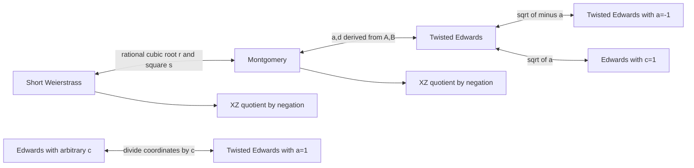

# Curve models, coordinates, and prime-field relation experiments

This atlas extends the original four-model EFD export. The machine-readable
[catalog](../transformations/catalog.json) adds eight conditional, reversible
model transformations, 40 prime-field coordinate representations in 13 model
families with native Weierstrass maps, and concrete
Curve25519, P-256 and secp256k1 cases. It does not classify every genus-one model.
See [additional formulas](additional-formulas.md)
for new doubling/ladder/tripling entries and a separate degree-two isogeny recipe.
The unified database also indexes 19 binary representations separately. General
isogeny catalogs and higher-genus covers remain future work. See
[coverage and verification](coverage-and-verification.md) for imported families
and the limits of each verification method.

Use `python tools/curve_map.py` for the complete inventory or
`python tools/curve_map.py --curve p256` for a particular curve. `--json` exports
all metadata or a selected curve. The inventory tool needs only Python's standard
library. It reports conditional edges; it does not infer field extensions or
claim every path is available for every curve.

## The transformation map



All parameters and square roots must belong to the field in which the map is
claimed. The catalog uses the repository's exact Edwards convention
`x^2+y^2 = c^2*(1+d*x^2*y^2)`, including `c`; assuming that every Edwards file
means `c=1` would give wrong maps. Catalog expressions use `**`, exact rationals,
and simultaneous substitution. Existing EFD files retain their `^` convention.
Inverse expressions use target coordinates but **original source parameters**.
The `requires` and `affine_exceptions` fields are part of the map specification.
The test substitutions encode algebraic constraints; they do not prove that
required roots exist in a particular finite field.

For short Weierstrass `y^2=x^3+a*x+b`, choose a rational root `r` and a nonzero
`s` with `s^2=3*r^2+a`. Then

```
u = (x-r)/s, v = y/s
A = 3*r/s, B = 1/s
B*v^2 = u^3+A*u^2+u
```

A rational 2-torsion point is necessary, but is not alone sufficient for this
Montgomery normalization: the square condition matters. Conversely, every
nonsingular Montgomery model has rational 2-torsion `(0,0)`. For Montgomery
parameters `A,B`, the map `ex=u/v`, `ey=(u-1)/(u+1)` produces twisted parameters
`a=(A+2)/B`, `d=(A-2)/B`. These rational expressions omit some affine points.
On smooth projective completions, infinity maps to `(0,1)` and `(0,0)` maps to
`(0,-1)`. Other exceptional points require charts; division by zero is never a
valid implementation of the extension.

Curve25519 has `A=486662`, `B=1`, and `p=2^255-19`. A square root
`s^2=-486664` exists in this field. Multiplying `u/v` by `s` gives the RFC 7748
Edwards model with `a=-1`, `d=-121665/121666`. Choose the sign of `s` consistently
with the chosen base point. Both curves have cofactor 8; X25519 input/output
semantics and clamping are a protocol layer, not a model isomorphism.

P-256 has `a=-3`, cofactor 1 and odd prime group order. Hence it has no rational
2-torsion, and has no Montgomery or nonsingular Edwards model over its base
field. This applies to any odd-order base-field elliptic-curve group, including
secp256k1; that curve instead benefits from the existing `a=0` formulas. Passing
to an extension changes model availability but must be tracked explicitly.
Same-field isogenies preserve point counts, so they cannot remove this
obstruction in an odd-order isogeny class.

## Coordinate representations

The `path` field links every representation to its native `variables` file;
assumptions, lifts and affine conversion formulas stay canonical there.

| Representation | Information and constraints | Useful measurements |
| --- | --- | --- |
| SW projective | `x=X/Z`, `y=Y/Z` | Homogeneous relation degree, chart selection |
| SW Jacobian | `x=X/Z^2`, `y=Y/Z^3`; general, a=0, a=-3 | Group arithmetic baseline, weighted equation size |
| SW modified Jacobian | Also `T=a*Z^4` | Cached doubling costs versus extra constraint |
| SW XYZZ | `x=X/ZZ`, `y=Y/ZZZ`, `ZZ^3=ZZZ^2` | Cached arithmetic and solver variable overhead |
| SW W12 | `x=X/Z`, `y=Y/Z^2`; requires b=0 | Specialized models only; unavailable directly on the listed curves |
| Montgomery/SW XZ | `x=X/Z`, loses sign of y | Differential arithmetic, quotient relations |
| Edwards projective | `x=X/Z`, `y=Y/Z` | Polynomial relation systems |
| Edwards inverted | `x=Z/X`, `y=Z/Y` | Excluded axes and extra charts |
| Twisted extended | `x=X/Z`, `y=Y/Z`, `XY=ZT` | Low-degree equations with extra variable; T has weight 1 |
| Edwards YZ / squared YZ | Require c=1 and square d, lose signs | Restricted quotient experiments; edwards25519 d is nonsquare |

A quotient coordinate is not an invertible point representation. XZ describes
`E/{+1,-1}`; differential addition needs a known difference. Recovering a full
point requires a square-root choice, and arbitrary x inputs can correspond to
the quadratic twist. Keep sign ambiguity and cofactor handling in relation
verification. Do not apply full-point addition rules directly to the quotient.

## What to test for index calculus

A birational model change transports the same ECDLP. It can change equation
sparsity, elimination order, available symmetries and arithmetic constants. It
does not supply the small factor base and sufficiently cheap point
decomposition needed for an index-calculus speedup. No result in this extension
establishes such a speedup on Curve25519 or P-256.

For short Weierstrass, the three-point summation polynomial is

```
f3(x1,x2,x3) = (x1-x2)^2*x3^2
              -2*((x1+x2)*(x1*x2+a)+2*b)*x3
              +(x1*x2-a)^2-4*b*(x1+x2)
```

It has multidegree `(2,2,2)` and encodes existence of sign choices with sum zero
over the algebraic closure. Over the base field, roots of the relation must be
checked for rational lifts and the desired subgroup. It is not a relation
collection algorithm by itself. See [Semaev's original reference](https://eprint.iacr.org/2004/031)
(the PDF could not be fetched during this work).

Run `python tools/relation_profile.py --curve curve25519` to compare this *same*
relation in three affine quotient coordinates, over the actual prime field:

| Coordinate | Total degree | Multidegree | Nonzero terms |
| --- | ---: | --- | ---: |
| SW x | 4 | (2,2,2) | 13 |
| Montgomery u | 4 | (2,2,2) | 11 |
| Edwards y | 6 | (2,2,2) | 9 |

These are measured equation metrics, not solver timings. The Edwards expression
comes from `u=(1+y)/(1-y)` and denominator clearing; the domain excludes every
`y_i=1`. Nine terms may help some solvers while increased degree may hurt others.
Different explicit Edwards relations may yield other presentations; this is
only a reproducible initial comparison.

A useful next experiment should:

1. Choose small nonsingular prime-field curves in separate cofactor-8 and
   prime-order families; use known point counts and identical subgroup instances.
2. Compare SW affine x, Montgomery u and Edwards y where field conditions allow.
   Also compare full-point polynomial systems with projective/extended variables,
   fixing a scale or using appropriate projective charts.
3. Transport one fixed factor base through each map first, so representation
   costs can be compared fairly. Then test newly defined bases separately.
4. Saturate by the product of every cleared denominator (or introduce
   `w*denominator_product-1=0`), and handle excluded charts independently. Plain
   denominator clearing can add spurious solutions.
5. Record relation probability, decomposition time, degree of regularity,
   matrix dimensions, peak memory, invalid/subgroup-rejected solutions and
   linear-algebra cost. State solver, monomial order and all heuristic assumptions.
6. Compare total work, including base conversion and relation verification, to
   Pollard rho on the same subgroup. Favorable small-field timings do not by
   themselves establish asymptotic improvement at 255/256 bits.

For prime fields, `F_p` has no proper subfields. Treating integer encodings or
radix limbs as extension-field coordinates is not a valid Weil-descent argument;
carry constraints and arithmetic modulo p still have to be paid for. Bounds and
heuristics for small-characteristic extension fields cannot simply be reused.
A field extension may make additional transformations possible, but also changes
the ambient problem and variable count. A quadratic twist is generally a
different base-field group, and an isogeny has a kernel; neither is an ordinary
coordinate change. The catalog tracks these operations separately.

## Validation and scope

The inventory tool has no dependencies. Verification and relation profiling use
SymPy (tested with version 1.14.0):

```
python -m pip install -r tests/requirements.txt
python -m unittest discover -s tests -v
python tools/curve_map.py --curve prime256v1 --json
python tools/relation_profile.py --curve curve25519
```

Tests check symbolic curve identities and both inverse compositions for all
maps, all existing reversible coordinate conversions, homogeneous weights,
RFC 7748 normalization and base-point consistency, nonsingularity, and base-point
subgroup scalar orders for all three curves. A polynomial gcd against `x^p-x`
independently confirms absence of rational 2-torsion for P-256 and secp256k1.
Published prime orders/cofactors come from RFC 7748 and SEC 2; the tests are not
independent point-count or primality certificates. Symbolic checks are on the
stated open charts, not implementations of all exceptional projective charts.

The extension also corrects native modified Jacobian and W12 affine denominators,
extended-coordinate T weights, and explicit multiplication in legacy
Weierstrass maps. Existing formula identifiers and operation code are preserved.
